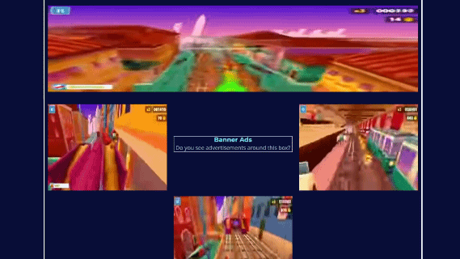

# Subway surfer gameplay ad-~~blocker~~-replacer

Because you should learn how to focus.

Firefox extension trying its best to replace ad panels with subway surfer gameplay for extreme focus improvements. Produced as part of super serious cognitive tests run by 2 fools who were bored when they should've been doing their actual jobs as teachers on that day.

The visuals were made extra crappy (144p) to ensure your eyes will squint trying to understand what's going on.

<p align="center">
  
</p>

This project is a valid crashout on vibe coded projects. The ungodly mixture of slop holding it together would make Taco bell beefy five layer burritos look healthy for humans.

Over 130 billion dollars raised by Anthropic since 2021, and one of its babies is producing this absolute nightmare of a project that will inevitably convince fake-job marketing specialists that being a developer consists of talking to an algorithm they nowadays probably consider a friend.

Opus 5.5 **High effort** made this, and what the actual fuck is **ULTRACODE** even supposed to mean ? Whatever business slop that was, it was enabled.

To whoever reads this, if you actually put this mess into your browser, let the Subway Surfer gameplay on whatever dev blog you were scrolling remind you that solely asking things to claude does not make you a software engineer, nor does it make you special.

# Install

Firefox only (desktop). Chrome, Edge, Brave and friends won't run it.

Not sure which way to pick? Here:

| You want to... | Your Firefox | Pick |
| --- | --- | --- |
| Just try it | Any Firefox | [Way 1](#way-1-just-try-it-any-firefox) |
| Keep it forever | Developer Edition, Nightly or ESR | [Way 2](#way-2-keep-it-developer-edition-nightly-esr) |
| Keep it forever | Normal Firefox | [Way 3](#way-3-keep-it-on-normal-firefox) |

Which Firefox do I have? Menu (the 3 lines, top right) > **Help** > **About Firefox**. If it doesn't say Developer Edition or Nightly, and the version number doesn't end with `esr`, you have normal Firefox.

## Way 1: just try it (any Firefox)

Takes 2 minutes. Firefox removes it when you close Firefox.

1. Open the [latest release](https://github.com/mbcraft-exe/Subway-Surfer-Ad-Block/releases/latest).
2. Under **Assets**, **right-click** the `.xpi` file > **Save Link As...** and save it somewhere you will find it again (your Desktop, for example).
   Don't left-click it: Firefox would try to install it right away and say it could not be verified. Normal, Mozilla didn't sign it.
3. In the Firefox address bar, type `about:debugging#/runtime/this-firefox` and press Enter.
4. Click **Load Temporary Add-on...**
5. Pick the `.xpi` file you just saved and click **Open**.
6. Done. Go to any website with ads and enjoy the gameplay.

Closed Firefox and it's gone? That's what temporary means. Do steps 3 to 5 again (keep the `.xpi` file), or use Way 2 or Way 3.

## Way 2: keep it (Developer Edition, Nightly, ESR)

Normal Firefox only accepts extensions signed by Mozilla. These 3 versions let you turn that check off.

1. Type `about:config` in the address bar, press Enter, click **Accept the Risk and Continue**.
2. Search for `xpinstall.signatures.required`.
3. Double-click it so it says `false`.
4. Download the `.xpi` ([Way 1](#way-1-just-try-it-any-firefox), steps 1 and 2).
5. Type `about:addons` in the address bar, then drag and drop the `.xpi` file onto that page.
6. Click **Add**. It now survives restarts.

This switch lets any unsigned extension in, so only install the ones you trust.

## Way 3: keep it on normal Firefox

You ask Mozilla to sign your own copy. It's free, it stays private (nothing gets published on the add-ons store) and it takes about 10 minutes. You need a terminal, `git`, `make`, `zip`, `python3` and [Node.js](https://nodejs.org).

1. Get the code:
   ```
   git clone https://github.com/mbcraft-exe/Subway-Surfer-Ad-Block.git
   cd Subway-Surfer-Ad-Block
   ```
2. Open `manifest.json` and change the `id` to something only you would use, like `sws-adblock@your-name`. An id belongs to the first person who signs it: if someone already signed `sws-adblock@local`, yours gets refused.
3. Log in on [addons.mozilla.org](https://addons.mozilla.org), open [Manage API Keys](https://addons.mozilla.org/developers/addon/api/key/) and generate your keys.
4. Paste them in the terminal, then sign:
   ```
   export WEB_EXT_API_KEY="user:12345678:123"
   export WEB_EXT_API_SECRET="your-secret"
   make sign
   ```
5. Wait a few minutes. The signed `.xpi` lands in `dist/signed/`.
6. Type `about:addons` in Firefox, drag and drop that file onto the page, click **Add**. No `about:config` needed.

Signing again after a change? Raise `version` in `manifest.json` first: Mozilla never signs the same version twice.

## Uninstall

- Way 1: close Firefox. Or `about:debugging#/runtime/this-firefox` > **Remove**.
- Way 2 or 3: `about:addons` > the **...** next to *Subway Surfers Ad Replacer* > **Remove**.

# Change the video

What plays instead of the ads is listed in one small file: `video/playlist.txt`, one file name per line. Each ad picks one of them at random, and starts it at a random moment.

```
sws.webm
my-clip.webm
cat.gif
```

Images work too (`.gif`, `.png`, `.jpg`, `.webp`, `.avif`, `.svg`). Yes, the folder is called `video`. It lies.

## 1. Get the code

- No git? On the GitHub page, green **Code** button > **Download ZIP**, then unzip it.
- With git: `git clone https://github.com/mbcraft-exe/Subway-Surfer-Ad-Block.git`

## 2. Make your video small

You need [ffmpeg](https://ffmpeg.org/download.html). This turns any video into a tiny, silent, 144p WebM:

```
ffmpeg -i my-video.mp4 -t 300 -an -vf scale=-2:144 -c:v libvpx-vp9 -b:v 90k -row-mt 1 -cpu-used 5 video/my-clip.webm
```

| Piece | Meaning |
| --- | --- |
| `-i my-video.mp4` | your video (mp4, mkv, mov... anything) |
| `-t 300` | keep the first 300 seconds (5 minutes). Remove it to keep everything |
| `-an` | no sound (ads are muted anyway) |
| `-vf scale=-2:144` | 144p, as the authors intended. `360` if you value your eyes |
| `-b:v 90k` | 90 kilobits per second, about 0.7 MB per minute. Bigger picture, bigger number (`300k` for 360p) |
| `-row-mt 1 -cpu-used 5` | encode faster |

5 minutes at 90k = 300 s x 90 kbit / 8 = about 3.4 MB, the size of the current video.

Images need no conversion. Just keep them small.

## 3. Add it to the playlist

1. Put your file in the `video/` folder. No spaces in the name: `my-clip.webm`, not `my clip.webm`.
2. Open `video/playlist.txt` and add its name on a new line.
3. Only want yours? Delete the `sws.webm` line. Want one more often? Write its name twice.

## 4. Load it in Firefox

- Quick test: `about:debugging#/runtime/this-firefox` > **Load Temporary Add-on...** > pick `manifest.json` inside the folder. Changed something again? Click **Reload** under the extension.
- To keep it: build a new `.xpi` with `make` (see [Build it yourself](#build-it-yourself)), then install it with Way 2 or Way 3.

## Tips

- The video is stretched to fill each ad. Rather crop than stretch? In `content.css`, change `object-fit: fill` to `object-fit: cover`.
- Every file in the playlist goes inside the extension. 10 videos of 3 MB make a 30 MB extension.
- WebM plays in every Firefox. MP4 may not play on some Linux setups.

# Tweak other things

| I want to... | Change this |
| --- | --- |
| Catch an ad box that slips through | add a CSS selector to `EXTRA_SELECTORS` in `filters.js` |
| Stop replacing a normal embed (video player, map...) | add its domain to `EMBED_HOSTS` in `content.js` |
| Catch ad frames of another size | add `[width, height]` to `AD_SIZES` in `content.js` |
| Change the look of the video boxes | `content.css` |
| Refresh the filter list more or less often | `UPDATE_EVERY_MS` in `background.js` (4 days) |
| Ship the newest filter list inside the extension | run `make update-filters` |

After a change: **Reload** in `about:debugging`, or rebuild with `make`.

# How it works

1. **Block**: requests to ad servers listed in [EasyList](https://easylist.to) are cancelled before they load.
2. **Spot**: EasyList's element rules, a few extra selectors (`filters.js`) and frames with classic ad sizes (300x250, 728x90...) tell which boxes on the page are ads. Boxes that never get a size are simply hidden.
3. **Replace**: each ad box becomes a box of the same size playing a random file from `video/playlist.txt`, muted and looping. Videos pause when you scroll them out of sight.
4. **Stay fresh**: a copy of EasyList ships in `filters/easylist.txt`, and the extension downloads a fresh one every 4 days.

## Privacy and permissions

- No tracking, no analytics, no data about you sent anywhere. The manifest declares that it collects no data.
- The only thing it downloads by itself: EasyList, from `easylist.to`, every 4 days.
- `webRequest` and `webRequestBlocking`: to cancel ad requests.
- `storage`: to keep the downloaded filter list.
- `<all_urls>`: to work on every website.

# Build it yourself

You need `make`, `zip` and `python3`.

- Debian/Ubuntu: `sudo apt install make zip python3`
- Arch: `sudo pacman -S make zip python`
- macOS: `xcode-select --install`
- Windows: use WSL, or skip building: Way 1 and **Load Temporary Add-on** > `manifest.json` need no build.

| Command | What it does |
| --- | --- |
| `make` | builds `dist/sws-extension-<version>.xpi` |
| `make lint` | checks the extension with Mozilla's `web-ext lint` (needs Node.js) |
| `make sign` | gets a Mozilla-signed `.xpi` in `dist/signed/` (see [Way 3](#way-3-keep-it-on-normal-firefox)) |
| `make update-filters` | downloads the latest EasyList into `filters/easylist.txt` (needs curl) |
| `make clean` | deletes `build/` |
| `make fclean` | deletes `build/` and `dist/` |
| `make re` | `fclean`, then `make` |

# FAQ

**"This add-on could not be installed because it has not been verified"**
You left-clicked the `.xpi`, or dropped it into normal Firefox. Use Way 1, or Way 3 to keep it.

**The extension disappeared**
Way 1 is temporary: Firefox removes it when it closes. Load it again, or use Way 2 or Way 3.

**`make: *** No rule to make target 'video/something.webm'`**
`video/playlist.txt` names a file that isn't in `video/`. Check the spelling (capitals count) or remove that line.

**Black boxes instead of the video**
No file from the playlist could be loaded: check the names in `video/playlist.txt`. Some websites also forbid it, nothing to do there.

**A website looks broken**
Switch the extension off for a moment in `about:addons`.

**Chrome? Edge? Brave?**
No. Firefox only.

# Project structure

```
manifest.json         extension ID card: name, version, permissions, scripts
background.js         loads EasyList, blocks ad requests, tells pages which boxes are ads
filters.js            reads EasyList rules (+ a few extra ad selectors)
playlist.js           picks a random file from video/playlist.txt for each ad
content.js            runs in every page: finds ad boxes, swaps them for the video
content.css           style of the video boxes
filters/easylist.txt  bundled copy of EasyList
video/playlist.txt    what plays instead of ads, one file name per line
video/sws.webm        the gameplay (256x144, 5 minutes, no sound)
Makefile              build, lint, sign, update the filters
demo.gif              the demo at the top of this page
AGENTS.md             rules for AI agents working on this repo
```

# Contributing

- Keep a pull request about one thing. Say what changes, why, and how to test it in Firefox.
- Write the pull request like this README: same Markdown, same tone. The template is in [AGENTS.md](AGENTS.md#pull-requests).
- Changed how people install, use or customize the extension? Update this README in the same pull request.
- Using an AI agent? Make it read [AGENTS.md](AGENTS.md) first. Then read what it wrote before you send it. You know why.

# Final note

QUIT BEING DEPENDANT