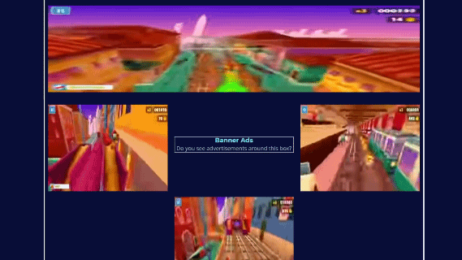

# Subway surfer gameplay ad-~~blocker~~-replacer

Because you should learn how to focus.

Firefox extension trying its best to replace ad panels with subway surfer gameplay for extreme focus improvements. Produced as part of super serious cognitive tests run by 2 fools who were bored when they should've been doing their actual jobs as teachers on that day.

The visuals were made extra crappy (144p) to ensure your eyes will squint trying to understand what's going on.

<p align="center">
  
</p>

This project is a valid crashout on vibe coded projects. The ungodly mixture of slop holding it together would make Taco bell beefy five layer burritos look healthy for humans.

Over 130 billion dollars raised by Anthropic since 2021, and one of its babies is producing this absolute nightmare of a project that will inevitably convince fake-job marketing specialists that being a developer consists of talking to an algorithm they nowadays probably consider a friend.

Opus 5.5 **High effort** made this, and what the actual fuck is **ULTRACODE** even supposed to mean ? Whatever business slop that was, it was enabled.

To whoever reads this, if you actually put this mess into your browser, let the Subway Surfer gameplay on whatever dev blog you were scrolling remind you that solely asking things to claude does not make you a software engineer, nor does it make you special.

# Install

You could change the `sws.webm` video if you wanted to.

Run

```
make
```

and the extension builds in `/dist`. Drag and drop the `.xpi` file in firefox. It will only work if you accept unsigned extensions or enable temporary extensions in developer settings.

# Final note

QUIT BEING DEPENDANT